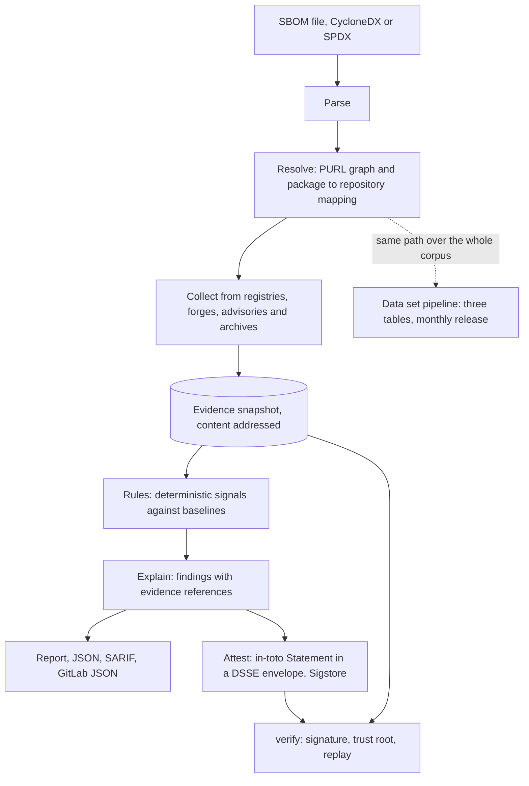
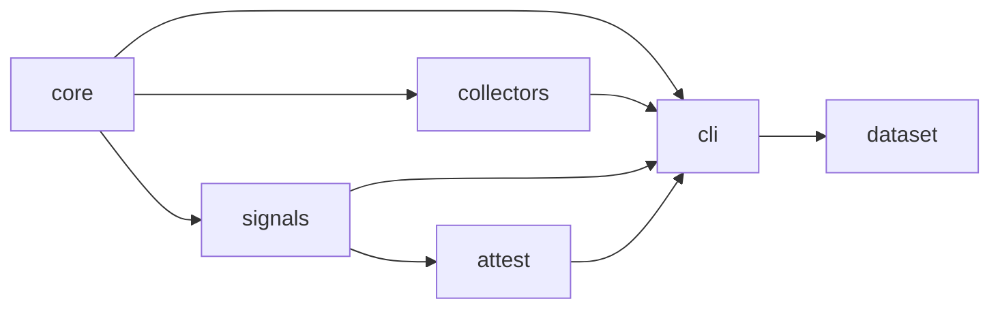

# Architecture

A run begins with an SBOM and ends with findings, optionally wrapped in a signed attestation. Between the two sit a parser, a resolver, the collectors, the rule engine and the explainer, all of them reading from and writing to one evidence store.

The arrows above are the only data flows there are. Nothing to the right of the snapshot talks to the network, and the data set pipeline is the same code run over a list of packages instead of one SBOM.

## From SBOM to findings

Parsing comes first. CycloneDX 1.5 to 1.7 is read with cyclonedx-python-lib and SPDX 2.2 and 2.3 with spdx-tools; SPDX 3.0.1 waits for a mature Python parser. What comes out is a list of components with their declared Package URLs and the dependency edges between them.

Resolution turns that list into a graph. Every component receives a normalised Package URL, the transitive graph is built, and for each package the source repository is worked out by combining the registry's repository field, the link ecosyste.ms knows, the link deps.dev knows and, where present, publisher provenance such as npm provenance or crates.io trusted publishing. The result is a mapping row with the repository, the forge, a confidence class and the number of sources that agree. Components whose Package URL type has no registry behind it, such as `pkg:generic`, `pkg:deb` or `pkg:github`, follow the repository-only path from here on.

Collection fills the evidence store. The collectors fetch npm packuments, crates.io versions and owners, git history, GitHub metadata, the metadata of other forges through ecosyste.ms, advisories from OSV and VulnerableCode, Scorecard results, OSS Rebuild attestations, archived packuments from the Wayback Machine and historical GitHub events from the ClickHouse public dataset. Each fetch lands in a content-addressed snapshot with its URL, time, selected headers and digest. In offline mode the collectors read a snapshot or the published data set instead of the network.

The rule engine never sees the network. It is a pure function of the snapshot, the rule set and the baselines, and it yields a signal state per component for the defaults S1 to S5, the context signal C1 and the experimental signals E1 to E3.

The explainer turns each signal state into a finding that carries the rule identifier and version, the inputs, the sources, the timestamps, the threshold, the baseline and references into the snapshot. One structure, rendered as a terminal report, as JSON, as SARIF and as a GitLab dependency-scanning report.

Attestation, when requested, wraps the findings, the digests of the release artefacts and the digest of the snapshot in an in-toto Statement with the project's predicate, puts it in a DSSE envelope and signs it with Sigstore, through the sigstore-python library or, on GitHub, through actions/attest.

Three things consume the result: the continuous-integration report with its warn-by-default policy, the `verify` command with which an auditor replays a snapshot and checks the signature against a trust root, and the data set pipeline, which runs the same path over the whole corpus and publishes the monthly release.

## Where the code lives

| Stage | Package | Takes | Produces |
| --- | --- | --- | --- |
| Parse | core | an SBOM file | components, declared Package URLs, dependency edges |
| Resolve | core | the components | the Package URL graph and mapping rows with confidence |
| Collect | collectors | the graph | an evidence snapshot |
| Rules | signals | snapshot, rule set, baselines | signal states per component |
| Explain | signals | signal states | findings with evidence references, in four renderings |
| Attest | attest | findings, artefact digests, snapshot digest | a signed DSSE envelope |
| Data set | dataset | the corpus list | three tables, catalogue metadata, a release |

The snapshot format and the collector interfaces are defined in `core`, so `collectors` depends on `core` and `signals` depends on `core` alone, never on live clients. `attest` depends only on the output types of `signals`. The command in `cli` wires everything together and `dataset` reuses its entry points over the corpus.

An import that goes against an arrow is a bug, and the test suite checks the package graph with a small import-linter rule so that it cannot drift.

## What happens in a run, step by step

The command opens the SBOM and hands it to the parser, which raises an input error (exit code 2) if the format or the schema version is not supported. The resolver normalises each component's Package URL, builds the graph and asks the mapping layer for a repository per package; a package with no resolvable repository is kept with confidence none and is still evaluated on the registry side. The collectors run next, in parallel per host with the rate limits described in `05-collectors.md`, and every response is written to the snapshot before anything derives from it, so that a crash in a later stage leaves a complete snapshot behind. When all collectors have finished or given up, the manifest is written and the snapshot digest is fixed. The rule engine then loads the snapshot, the rule set and the baselines, evaluates every signal for every component and returns states; the explainer turns states into findings and renders them. Attestation, if asked for, is the last step and the only one that needs the artefact digests. Every stage logs one line per component at debug level and one summary line at info level, with the run identifier on every line, so that a run can be followed in CI logs without reading the snapshot.

## Invariants

The rule engine and the explainer read the snapshot and nothing else, and that is what makes a replay byte-identical. Every output names its inputs: the rule set version, the baseline version, the snapshot digest and the tool version. Findings and the predicate are serialised canonically, with sorted keys, fixed number formatting and UTC timestamps, so that two runs on the same snapshot produce the same bytes. The tool exits with status zero on findings unless the user chooses a fail policy. Public account handles stay inside the snapshot, while the published outputs carry keyed hashes, as `11-privacy-and-licensing.md` explains.

## The SBOM is not quite private

Online lookups during collection reveal the component list to the services queried. Offline mode against local dumps and the published data set is a supported path for that reason, and the command prints which services it is about to query and lets the user restrict them.

## Open for milestone M1

The mapping table may carry per-source votes or only the resolved repository and a confidence class. The catalogue metadata profile, DCAT-AP 3.0.1 or a Frictionless Data Package, is to be confirmed with NLnet and AboutCode. The repository-only baseline for Package URLs without a registry should draw on corpus repositories matched by activity profile rather than by ecosystem, and its exact construction is open.
