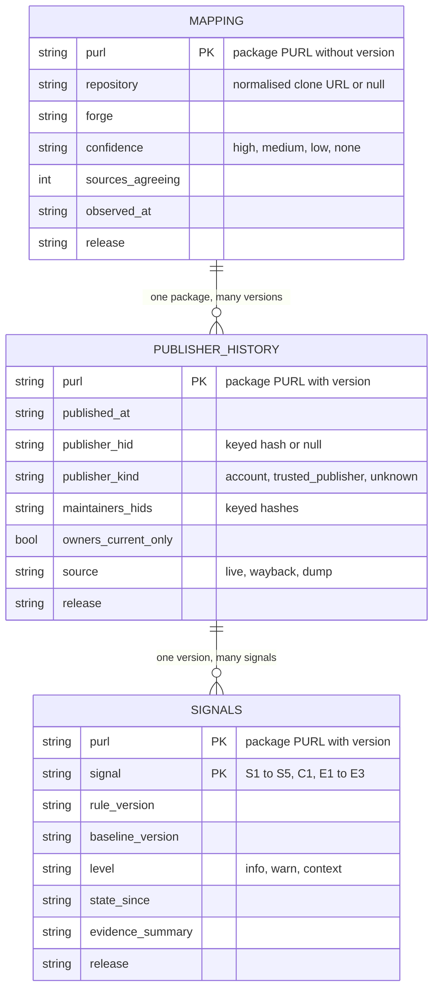

# Data model

The JSON Schemas will live in `schemas/`; this document is their narrative.

## Keys and identities

Everything is keyed by Package URL as defined by the package-url specification, so a row is identified by type, namespace, name, version and qualifiers. A repository is identified by a normalised clone URL together with a forge identifier, one of github, gitlab, codeberg, sourcehut, gitea or other.



The three tables join on the Package URL: the mapping row is per package, the publisher-history row per version, and the signals rows per version and signal. A consumer that only wants the repository links reads the first table alone; a consumer that wants to know who published what reads the second; the third only makes sense together with the rule versions it names.

## A worked example

Take a fictional npm package `example-stream`. Its mapping row says the package resolves to a repository on GitHub with high confidence, because the registry field and ecosyste.ms agree. Its publisher-history rows list every version with its date; up to version 3.3.4 the publisher hash and the single maintainers hash are the same identity, from 3.3.5 a second identity appears in the maintainers field and is also the publisher, and the rows carry `source: wayback` because the versions were later removed from the registry. Its signals rows for 3.3.5 and 3.3.6 show S3 at warn level, since the publisher of 3.3.5 was not in the maintainers field of 3.3.4, and S1 at warn level under the floor branch, since the previous maintainer had no commits in the twelve months before the new identity gained rights; the `state_since` of S1 is the date of 3.3.5. C1 appears on both rows as context with the value one. This is what the catalogue and the tool must agree on byte for byte.

Identities, meaning publishers, maintainers and committers, appear in two forms. A handle is the public account name as the registry or forge shows it, and it is stored only inside evidence snapshots. A keyed hash is an HMAC-SHA256 over the registry or forge name and the handle, computed with a key the project holds; it is rendered as `h:` followed by the first eight hexadecimal characters in human-readable output and in full in machine output, and it is what the published data set and the attestations carry. Because handles can be enumerated, a keyed hash is pseudonymous rather than anonymous. E-mail addresses are never stored anywhere.

## The mapping table

One row per package, without version, per release.

| Field | Type | Meaning |
| --- | --- | --- |
| purl | string | the package's Package URL without version |
| repository | string or null | the normalised clone URL |
| forge | enum | github, gitlab, codeberg, sourcehut, gitea, sbom, other, unknown |
| confidence | enum | high, medium, low, none |
| sources_agreeing | integer | how many consulted sources agree with the resolved repository |
| sources | array | which sources were consulted |
| observed_at | timestamp | when the mapping was computed |
| release | string | the data set release identifier |

The draft confidence rule is that high means the registry field and at least one independent source agree, or that publisher provenance names the repository; medium means a single source; low means the sources disagree and the most-voted wins; none means nothing was found.

## The publisher-history table

One row per package version.

| Field | Type | Meaning |
| --- | --- | --- |
| purl | string | the Package URL with version |
| published_at | timestamp | from the registry, the `time` map on npm or `created_at` on crates.io |
| publisher_hid | string or null | keyed hash of the publishing account, null where the registry does not expose it |
| publisher_kind | enum | account, trusted_publisher, unknown |
| maintainers_hids | array | keyed hashes of the maintainers field at that version on npm, or of the current owners on crates.io |
| owners_current_only | boolean | true when the owners could only be observed as they are today |
| source | enum | live, wayback, dump |
| observed_at | timestamp | |
| release | string | |

The known limits of the sources are recorded in the rows themselves. On npm the `_npmUser` field is absent before 2014 and reads "GitHub Actions" with a `trustedPublisher` block under trusted publishing. On crates.io `published_by` is null before 2017 and under trusted publishing, and owner removals cannot be reconstructed from the daily dump, which is why owners are flagged as current only.

## The components table

One row per resolved node.

| Field | Type | Meaning |
| --- | --- | --- |
| ref | string | The Package reference |
| purl | string or null | The Package URL with version |
| package | string or null | The Package URL without version |
| is_root | boolean | True when the componet is the root |
| depth | integer or null | The dependency depth |
| via | string or null | Provenance chain leading to a transitive dependency |
| route | enum | registry, repository, unsupported, no_purl |

## The signals table

One row per package version, signal and release.

| Field | Type | Meaning |
| --- | --- | --- |
| purl | string | |
| signal | string | S1 to S5, C1, E1 to E3 |
| rule_version | string | semantic version of the rule as frozen in `spec/` |
| baseline_version | string | identifier of the baseline file |
| level | enum | info, warn, context |
| state_since | timestamp or null | for persisting states such as S1, when the state began |
| evidence_summary | array | objects with a claim, a source kind and an observation time, and no handles |
| threshold | string | a human-readable rendering of the rule instance |
| observed_at | timestamp | |
| release | string | |

## Findings

A finding carries the content of a signals row together with full evidence references into the snapshot. Field names in findings and in the attestation predicate follow the in-toto convention and are camelCase; the data set tables use snake_case, and the schemas document the correspondence. Each evidence item is an in-toto ResourceDescriptor whose `name` is the item's path inside the snapshot, whose `uri` repeats that path, whose `downloadLocation` is the snapshot archive held by the attesting party, whose `digest` is the item's own SHA-256 and whose `annotations` carry the claim and the observation time. The example below shows an S1 finding on a fictional package.

```json
{
  "purl": "pkg:npm/example-stream@3.3.6",
  "signal": "S1.handover",
  "ruleVersion": "1.0.0",
  "baselineVersion": "2027-08",
  "level": "warn",
  "stateSince": "2018-09-05T05:27:47Z",
  "evidence": [
    {
      "name": "npm/example-stream/packument.json",
      "uri": "evidence/2027-09-01T10Z/npm/example-stream/packument.json",
      "downloadLocation": "<storage of the attesting party>",
      "digest": {"sha256": "..."},
      "annotations": {
        "claim": "3.3.5 was published by an identity (h:9f3a2c71) not listed in the 3.3.4 maintainers field",
        "observedAt": "2027-09-01T09:58:12Z"
      }
    }
  ],
  "threshold": "S1 v1.0.0: drop branch or floor branch, and a new identity with publish rights; the state persists 24 months",
  "baseline": "baselines-2027-08: npm libraries with more than 1,000 dependents"
}
```

The attestation that wraps findings is described in `07-attestation.md`.

## Baselines

A baseline is a versioned JSON document per ecosystem, plus one for the repository-only path, holding the percentiles the rules refer to: the release-cadence p90 that defines dormancy, the distribution of twelve-month share drops across rights-grant anchors in the calibration corpus whose p90 is the S1 drop threshold, the commit floor of the S1 floor branch, and the minimum release count below which a project's own diff-size p95 is not computed. Baselines are computed from the time-split corpus of data before 2021 and referenced by digest from every attestation.

## Versioning

Rules carry semantic versions in `spec/`; a threshold change is a minor version and a definition change a major one. Baselines carry dated identifiers such as `2027-08` and are never edited after publication. Data set releases carry dated identifiers and a DOI each. Schemas carry `$id` URLs under the project domain with a version in the path.
