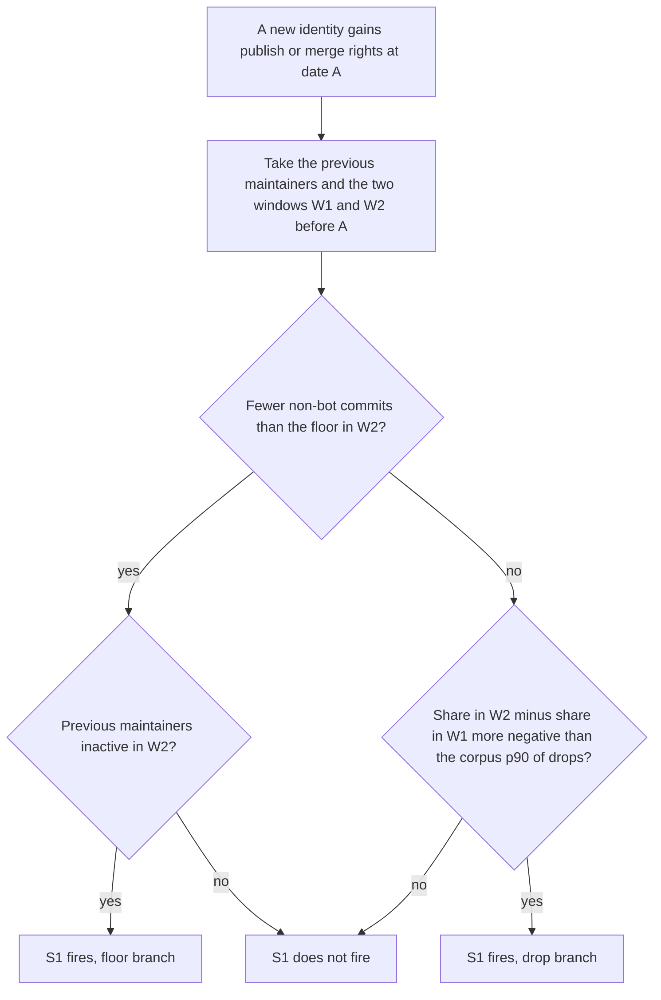
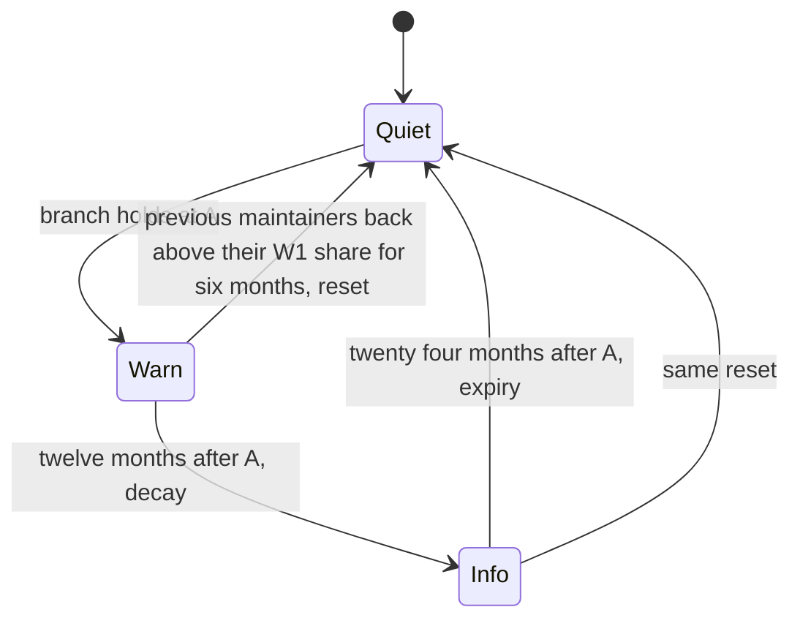

# Signal catalogue, version 1

The catalogue is frozen in milestone M1 with a DOI before any validation run. Signals marked S are defaults and ship switched on once they pass the control-set test; C1 is context, shown next to findings but never a finding; signals marked E are experimental and switched off unless asked for. Maven Central sources are follow-up scope.

Two incidents, xz-utils and event-stream, shaped these rules, so their lead time counts as a consistency check and not as evidence; `09-validation-protocol.md` explains how out-of-sample evidence is obtained.

## Vocabulary

A rights grant, written A below, is the date on which an identity obtained publish rights on a package, as recorded in the registry's maintainers field or owners, or merge rights on a repository, as shown by the forge-asserted actor of a push to the default branch or of a release event. The self-asserted tagger field of a git tag is never used as evidence. The previous maintainers are the identities that held publish or merge rights before A. The share of a set of identities in a window is their non-bot commits and merges divided by all non-bot commits and merges in that window; bots such as dependabot and renovate are excluded from both sides by a maintained list, and under squash merges the committer counts as the merger and the author as the contributor, both being recorded. The two windows the handover rule compares are W1, the twelve months ending twelve months before A, and W2, the twelve months ending at A.

## S1, maintainer handover

S1 fires when a new identity gains publish or merge rights and one of two branches holds for the previous maintainers. In the drop branch, their share in W2 minus their share in W1 is more negative than the ninetieth percentile of such drops across all rights-grant anchors in the calibration corpus, and both windows contain at least the commit floor. In the floor branch, W2 contains fewer non-bot commits than the floor and the previous maintainers are inactive in it. The state persists for twenty-four months from A, with a decay that lowers the level from warn to info after twelve months, a reset when the previous maintainers return above their W1 share for six months, and hysteresis so that single-month noise does not flip it.

The flowchart is the decision at the moment of the rights grant; the state diagram is what happens afterwards. Hysteresis means that the reset condition must hold for six consecutive months, so a single busy month by the old maintainer does not switch the state off and on.

The evidence comes from the npm `_npmUser` and `maintainers` fields per version, from the crates.io `published_by` field per version and the current owners in the dump, from git authors and committers, and from the forge-asserted actors of push and release events in the ClickHouse public GitHub events dataset, which derives from GH Archive.

In xz-utils the organisation membership dates from 28 October 2022; Collin's last tagged release was 5.4.1 on 11 January 2023 and Jia Tan's first was 5.4.2 on 18 March 2023. Jia Tan also authored every GitHub release object from the first one on 13 December 2022, so release-object authorship shows no change and the tagger does. In event-stream the new account published 3.3.5 on 5 September 2018 and the previous maintainer had no commits in the twelve months before, which is the floor branch.

The noise risk is high if the percentile is lax. The target of two per cent of packages warned per signal is partly a construction, since the percentile can be tuned to meet it, and so lead time rather than warn rate is the real test of this signal.

## S2, dormancy then burst

S2 fires on a release whose diff is above the project's own ninety-fifth percentile, subject to a minimum release count, when it comes within six months after an inactivity longer than the ecosystem's ninetieth percentile. It is reported mainly in combination with S1 or S3. The evidence is release timestamps and git history. The xz-utils dormancy of 2020 to 2022, followed by 5.2.6 and 5.4.0, is the motivating example; the malicious 5.6.0 itself followed no dormancy, so S2 is not claimed to fire on it.

## S3, publisher change

S3 fires when the account that published a version is not listed in the maintainers field of the previous version. A documented switch to trusted publishing is exempt, recognisable on npm by `_npmUser` reading "GitHub Actions" with a `trustedPublisher` block and on crates.io by a null `published_by`. The evidence is the npm `_npmUser` and `maintainers` fields per version and the crates.io `published_by` field. In event-stream S3 fires on 3.3.5, because the maintainers field of 3.3.4 listed only the original maintainer and 3.3.5 was published by the new account. It does not fire on ua-parser-js, where the hijacked account itself published, and it is not expected to.

## S4, source provenance

S4 records the presence or absence of publisher provenance, meaning npm provenance, PyPI attestations or crates.io trusted publishing, or of a rebuild attestation from Google OSS Rebuild, which covers npm, PyPI and crates.io and publishes attestations only for successful rebuilds. It is informational only. Missing provenance is reported and is never a warning on its own, and there is no naive comparison of a tarball against a tag, which would fire on every project with generated files.

## S5, unmaintained transitive dependency

S5 warns when a component is deprecated or its repository archived and an advisory against it has no fixed version in any release, or when there has been no release in thirty-six months and such an advisory exists. Deprecation alone is informational. The evidence is the npm deprecated flag, the PyPI status markers of PEP 792, the crates.io yanked flag, the repository's archived flag and the OSV bulk dump. The deprecated npm package `request` with CVE-2023-28155, never fixed in an npm release, is the standing example.

## C1, contributor absence factor

C1 is the CHAOSS metric of that name, formerly called bus factor: the smallest set of contributors who together produce half of the contributions. It is shown next to every finding as context and is never a finding.

## E1, ownership change

E1 records a repository transfer or an organisation change in the last 180 days, from registry metadata and from historical GitHub events. It is experimental because the events feed has carried almost only push events since mid-2025, so it serves reconstruction rather than current detection, and because WHOIS data has been redacted since GDPR. The polyfill.io case of 2024 motivates it, although polyfill.io was a CDN domain rather than an SBOM component.

## E2, release channel anomaly

E2 records a release built or signed differently from the previous ten, from provenance attestations and CI metadata. Such data rarely exists before 2024.

## E3, vulnerability handling

E3 records the presence of a security policy and an OpenSSF Security Insights file and the project's historical fix behaviour from OSV and Scorecard, as an ecosystem percentile of the current state.

## Warn-rate targets

Per default signal the target is at most two per cent of packages warned on a matched control set, reported with confidence intervals. Per SBOM, which is the binding target, at most three per cent of components may carry any default warning on the three reference SBOMs named in M1, a Node web application, a Rust command-line tool and a Node command-line tool; defaults are demoted in order of their contribution until the aggregate holds. Warn rate is defined per package at the snapshot date and, for a pinned version, also at that version's publish date, which is what was knowable then, and both are reported.

## Research the definitions draw on

## Adding or changing a signal

A signal is three artefacts that move together: its entry in the specification under `spec/`, which states the definition, the evidence it needs, the threshold idea and its known limits; its rule in `packages/signals`, a pure function from snapshot facts and baselines to a state; and its fixture, a recorded snapshot of a package on which the rule is expected to fire and one on which it is expected to stay quiet. The specification entry comes first and goes through the issue and comment process described in `CONTRIBUTING.md`, because a reviewer or a maintainer of an affected package must be able to read what the rule does without reading code. The rule then implements that entry and nothing more, and it records in every finding the rule version it belongs to. A threshold change bumps the minor version, a definition change the major version, and either one invalidates the control-set result of the previous version, so the warn rate is measured again before the new version ships as a default. Experimental signals follow the same path but skip the control-set gate until someone proposes promoting them.

Zimmermann and colleagues (USENIX Security 2019) on the risks of the npm ecosystem; Zahan and colleagues (ICSE-SEIP 2022) on weak links in npm; Coelho and Valente (FSE 2017) on why modern open source projects fail; Avelino and colleagues (ICPC 2016 and 2019) on truck factor and abandonment; Ladisa and colleagues (IEEE S&P 2023) for the attack taxonomy; Ohm and colleagues (DIMVA 2020) and Duan and colleagues (NDSS 2021) for malicious-package corpora; Vu and colleagues, LastPyMile (FSE 2021), for source-artefact mismatch; Coelho and colleagues (ESEM 2018) on unmaintained projects; Pinckney and colleagues, npm-follower (FSE 2023), for historical packuments; and the CHAOSS metric definitions.
