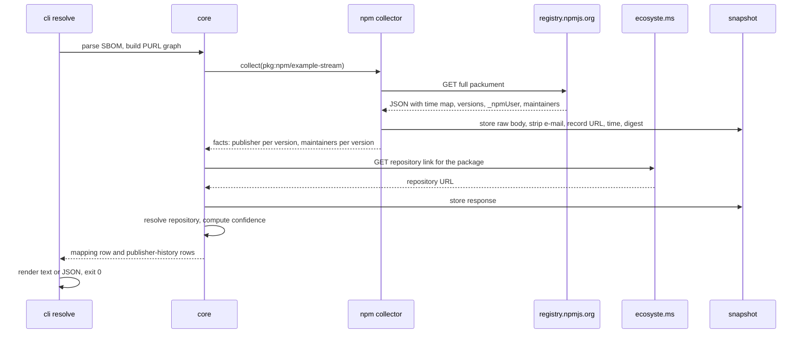

# Collectors

Every collector implements the same contract: given a Package URL or a repository, it fetches the documents it needs, records each fetch in the evidence snapshot with its URL, time, selected response headers, digest and raw body, and returns typed facts. Collectors never compute signals, and every collector has an offline mode that reads from a snapshot and returns exactly the same facts without touching the network. Collectors respect rate limits and terms of service, cache aggressively, strip e-mail addresses at ingestion while keeping a flag that one was present, and record every limitation of their source in the facts they return, for example that owners could only be observed as they are today.

In offline mode the two GET calls are replaced by reads from the snapshot and everything else is identical, which is what the replay test relies on.

## Writing a collector

A collector is a small module with two entry points, `collect` and `replay`, that return the same typed facts. Start from the fixture, not from the code: fetch the real document once with a descriptive User-Agent, store it under `tests/fixtures/<source>/` with the e-mail addresses already replaced by the marker, and write down in a comment which fields you rely on and which limits of the source you must flag in the facts. Then write `replay`, which parses that fixture into facts, and make its test pass. Only then write `collect`, which fetches, hands the body to the same parsing function and records the fetch in the snapshot index with URL, time, status, selected headers and digest. Rate limiting lives in the shared HTTP client, not in the collector; give the client the per-host policy and let it queue. Every limitation you know about becomes a boolean or an enum in the facts, for example `owners_current_only`, so that the rule engine can reason about missing history instead of mistaking it for absence of change. Finish by adding the collector to the services list that the command prints before an online run, so that a user who cares about SBOM privacy can see it and switch it off.

## The sources

| Source | What it gives | What to record about its limits |
| --- | --- | --- |
| npm registry, full packument | the `time` map per version; per version the `_npmUser` publisher, the `maintainers` field, `dist` and deprecation | `_npmUser` is absent before 2014 and reads "GitHub Actions" with a `trustedPublisher` block under trusted publishing; removed versions keep their date in `time` but lose their version object |
| Wayback Machine captures of registry.npmjs.org | packuments as they were, including removed versions such as event-stream 3.3.6 | a capture may not exist for the date needed; replicate.npmjs.com was retired in 2025 |
| npm-follower, dependencies.science | historical packument changes | coverage starts in mid-2022 |
| crates.io API, versions endpoint | `published_by` per version, `created_at`, yanked | `published_by` is null before 2017 and under trusted publishing; the crawler policy, believed to be one request per second with a descriptive User-Agent, is to be verified at crates.io/data-access |
| crates.io daily database dump | `versions.published_by` and the current `crate_owners` with `created_at` | removed owners are not exported, so there is no owner-removal history |
| git clones | authors, committers, dates, tags | tagger name and date are self-asserted and committer dates can be back-dated |
| GitHub REST API | repository metadata, the archived flag, current releases | the token inside Actions allows 1,000 requests per hour per repository; the live API no longer reliably serves the xz-utils release objects of 5.4 to 5.6 after the 2024 suspension |
| ClickHouse public GitHub events, derived from GH Archive | push, release and member event actors since 12 February 2011, about eleven billion rows | almost only push events since mid-2025, so it serves reconstruction and not current signals; organisation membership emits no event; it is a demo service without a service level, so extracts are cached locally and git clones are the fallback; the data is described as redistributable for research and has no formal licence, so only derived facts are republished |
| ecosyste.ms packages, repositories and commits APIs | package metadata across 110 sources and repository and commit facts for forges other than GitHub | the data is CC BY-SA 4.0 and the code AGPL-3; supporters are Schmidt Futures and Open Source Collective; bulk access is to be agreed, and registry APIs and git clones are the fallback |
| deps.dev public API | the dependency graph, repository links and Scorecard results | the BigQuery exports need a Google Cloud account, so the API is used |
| OSV API and bulk dump | advisories per Package URL and version range | an advisory counts as unfixed when no fixed version exists in any release, which is computed from the dump |
| VulnerableCode | advisories keyed by Package URL | a partner project of CodeSupply |
| OpenSSF Scorecard public results | twenty checks per repository | a snapshot model, current results only without Google Cloud |
| Google OSS Rebuild | rebuild attestations for npm, PyPI and crates.io | only successful rebuilds have attestations and no mismatch attestation exists |
| Libraries.io Open Data, Zenodo, January 2020 | packages and maintainers as of 2020 | CC BY-SA 4.0, used for calibration only and never republished |
| Software Heritage | source history and a deposit target for the project's own code | code, not forge or registry metadata |

## Resolving a package to its repository

The inputs per package are the registry's repository field, the repository link ecosyste.ms holds, the link deps.dev holds and, when present, publisher provenance from npm provenance, PyPI attestations or crates.io trusted publishing. The output is the resolved repository, its forge, a confidence class of high, medium, low or none, the number of agreeing sources and the list of sources consulted. Forks and mirrors are told apart by comparing default-branch history where a clone exists. Forges other than GitHub, such as GitLab, Codeberg, sourcehut and self-hosted Gitea, are reached through ecosyste.ms first and plain git second, so that no single platform's API becomes a point of failure.

## Answering what was knowable on a date

Validation and the publish-date evaluation both need the state of the metadata on a given date. For registries that means the packument `time` map and Wayback captures before that date. For repositories it means push and release timestamps from the events dataset where a feed exists and, elsewhere, committer dates flagged as self-asserted in the facts; commit dates are never used alone, so that a back-dated commit cannot leak into a window it does not belong to.

## What the prototype implements

The prototype implements the live npm packument collector, the crates.io API collector and the mapping from registry fields and ecosyste.ms. Git analysis and everything else are stubs with recorded fixtures, as `15-prototype-plan.md` describes.
