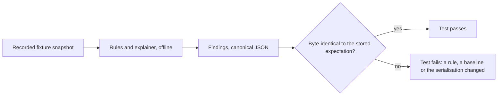

# Evidence store

The evidence store is what makes an assessment reproducible and an attestation verifiable, because the signal and explanation stages read only from it.

## What a snapshot is

A snapshot is a content-addressed tar archive. Inside it, under a run identifier made of a UTC timestamp and a short random suffix, an `index.json` lists every fetched document with its path, URL, fetch time, status, selected response headers, SHA-256, byte size, and the collector and collector version that produced it. The documents themselves sit in directories per source, for example `npm/<package>/packument.json`, `crates/<name>/versions.json`, `git/<repository>/authors-12m.json` for derived facts together with the commit range they derive from, `events/<repository>/push-release.json` for rows extracted from the events dataset and `osv/<purl>.json`. A `manifest.json` records the run identifier, the tool version, the digests of the rule set, the baselines and the SBOM, the list of services queried and the start and end times. The snapshot digest is the SHA-256 of the canonical tar, with sorted entries, fixed modification times and no owner information.

## Rules

Raw bodies are stored first, as fetched, and derived facts are stored next to them with the derivation recorded, so that a replay can recompute the derived facts from the raw bodies and compare. E-mail addresses are replaced at ingestion by a fixed marker, with a flag in the index that one was present, while public handles are kept. Every finding references snapshot paths through ResourceDescriptors whose `uri` is the path inside the snapshot, whose `downloadLocation` is the archive and whose `digest` is the item's own SHA-256. Everything is serialised canonically, with sorted keys, UTF-8, newline line endings, integers without exponents, UTC timestamps ending in Z and floats with a fixed number of decimals, so that two runs on the same snapshot produce byte-identical findings. Replay is a test: continuous integration replays the recorded fixtures and fails if any finding differs.

When the test fails on purpose, because a rule version changed, the stored expectation is regenerated in the same pull request and the diff of the expectation is part of the review.

## Who stores snapshots

A continuous-integration user stores its own snapshots, in the artifact storage of the run or in an object store it controls; the project never receives or publishes them, and the attestation carries only their digest and a download location the attesting party controls. For the validation protocol the project publishes the frozen snapshots used for the incident and control-set runs, so that others can re-run them; these reproduce public registry documents with e-mail addresses stripped. The data set pipeline keeps its snapshots for eighteen months after the release they belong to, long enough to answer disputes, and then deletes them; only the derived tables are published.

## The temporal store

The data set pipeline and the validation protocol need the metadata as it was on a given date. The temporal store is the set of snapshots plus an index by source, key and observation time that answers such point-in-time queries. It is the largest hidden cost of the project and is budgeted in milestone M2; its sources and their limits are described in `05-collectors.md`.

## Size and retention

A run over an SBOM of five hundred components produces a snapshot of some tens of megabytes, most of it packuments. The data set pipeline over ten thousand packages produces several gigabytes a month, and the server the applicant contributes, with four cores, sixteen gigabytes of memory and two terabytes of storage, is sized for twenty-four months of monthly runs with raw bodies compressed.

## Offline mode

The option `--offline` with a snapshot or with the published data set makes every collector read from it instead of the network. The command prints which services it would otherwise have queried and exits with a non-zero status if a required document is missing offline.
