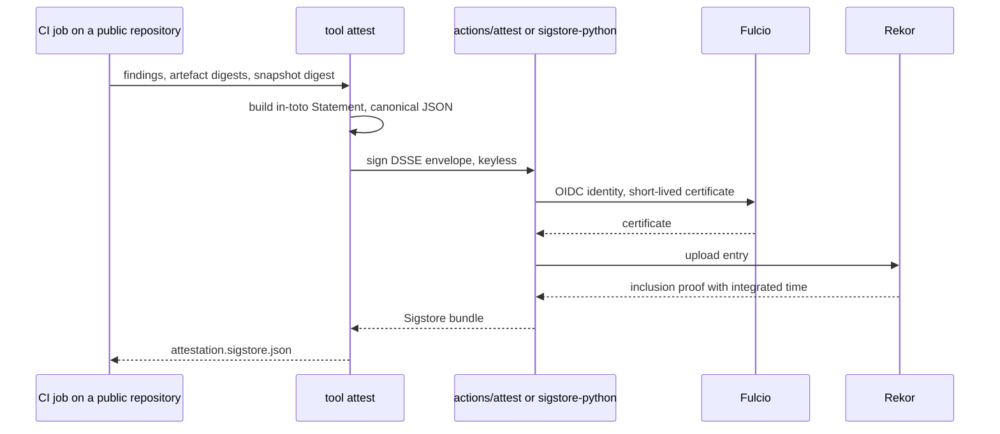
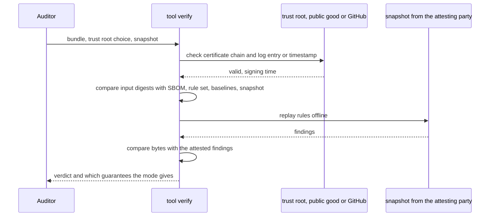

# Attestation

The predicate is finalised in milestone M4. The assessment is emitted as an in-toto Statement version 1 with a predicate defined by the project, wrapped in a DSSE envelope and signed with Sigstore.

## Why in-toto

Sigstore bundles, GitHub's actions/attest and GUAC already verify and store in-toto Statements, so a project that uses them inherits their verifiers. A bespoke manifest would have none, and OpenPGP signatures are accepted by no mainstream DSSE or in-toto implementation, which is why the earlier idea of signing with GPG was dropped. CycloneDX 1.6 attestations could carry similar claims inside an SBOM document but have fewer verifiers and stores today; the mapping to them will be documented. Among existing predicates, SCAI covers attribute assertions with evidence and VSA covers policy verification results, and neither carries a time-bounded, rule-based assessment with evidence references and the versions of rules and baselines, so the project defines a small predicate of its own and proposes it to the in-toto attestation repository. No registration exists; any URI is a valid predicate type and the proposal is an optional vetting.

## The shape of the statement

```json
{
  "_type": "https://in-toto.io/Statement/v1",
  "subject": [{"name": "myapp-2.3.0.tar.gz", "digest": {"sha256": "..."}}],
  "predicateType": "https://<project-domain>/attestation/dependency-health/v1",
  "predicate": {
    "assessedAt": "2027-09-01T10:00:00Z",
    "tool": {"name": "<project>", "version": "1.0.0"},
    "inputs": [
      {"name": "sbom", "mediaType": "application/vnd.cyclonedx+json", "digest": {"sha256": "..."}},
      {"name": "ruleset", "uri": "https://<project-domain>/spec/signals-1.0.0.json", "digest": {"sha256": "..."}},
      {"name": "baselines", "uri": "https://<project-domain>/baselines/2027-08.json", "digest": {"sha256": "..."}},
      {"name": "evidence-snapshot", "uri": "<storage of the attesting party>", "digest": {"sha256": "..."}}
    ],
    "summary": {"components": 412, "findings": 3, "policy": "warn"},
    "findings": ["see 03-data-model.md"]
  }
}
```

The subject is the set of release artefacts; the SBOM is an input referenced by digest. Inputs and evidence items are ResourceDescriptors with the fields `name`, `uri`, `downloadLocation`, `digest`, `mediaType` and `annotations`. There is no expiry field, because an attestation is a signed statement about the past and any expiry belongs to the consumer's policy. Identities in the predicate appear only as keyed hashes.

## Signing modes





The first diagram is the public keyless path; on a private repository the Fulcio and Rekor roles are played by GitHub's own instance and the inclusion proof is replaced by a signed timestamp. The second diagram is the same for every mode and is what an auditor runs years later.

For a public repository on GitHub, actions/attest signs the statement with the Sigstore public-good instance and records it in Rekor, whose entry gives the signing time; actions/attest accepts a custom predicate type and predicate path. Outside GitHub the sigstore-python library does the same through its API, because the `sigstore attest` command accepts only SLSA predicate types. Verification runs offline with sigstore-python against the public-good trust root, using its offline and trust-configuration options.

For a private repository, which requires GitHub Enterprise Cloud, actions/attest uses GitHub's own Sigstore instance, which according to GitHub's documentation has no transparency log and federates only with GitHub Actions, and which according to Sigstore's documentation embeds a signed timestamp from GitHub's timestamp authority. Verification then runs against an exported GitHub trust root.

A key-based mode for regulated environments, with cosign and a key, no transparency-log upload, an RFC 3161 timestamp from a self-hosted sigstore timestamp-authority and verification through securesystemslib, is specified in M4 and built in a follow-up, because sigstore-python has neither key-based signing nor key-based verification.

In every mode the signing time is proven by a transparency-log entry or a signed timestamp, which is what makes back-dating detectable.

## The verify command

`verify` takes a bundle, a trust root, which may be the public-good root, GitHub's root or a file, and optionally a snapshot. It verifies the DSSE signature and the certificate chain against the chosen root and checks the Rekor entry or the signed timestamp. It then checks that the digests in the inputs match the SBOM, rule set, baselines and snapshot it was given. With the replay option it re-runs the rules on the snapshot and compares the findings byte for byte. It states in plain words which guarantees the mode in use provides, distinguishing a public log from a GitHub-asserted timestamp.

## Threat model, to be completed in M4

The assets are the integrity of a finding, the time at which it was made, the privacy of the SBOM and the pseudonymity of the identities in the published outputs.

Someone who controls a dependency and knows the public rules can keep the old maintainer's commit share up with sock-puppet commits or publish from an inherited account. The signals rest on rights changes recorded by registries and forges; their purpose is to make handovers visible and to raise the cost of hiding one, not to catch every adversary, and the specification states this limit. Back-dating an assessment fails against the transparency-log entry or the signed timestamp, since a long-lived key without a timestamp is not an offered mode. Tampering with a snapshot fails against the digests, because every evidence item and the snapshot itself are referenced by digest and replay shows any change. Third parties learn the component list of an SBOM through online lookups, which is why offline mode and the list of queried services are first-class features. Keyed hashes can be re-identified in principle by enumerating handles; the key is held by the project and a dispute and objection path exists.
