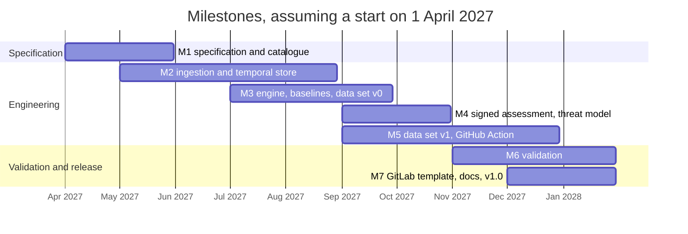

# Roadmap and milestones

This is the plan as proposed to NLnet's CodeSupply fund in October 2026. It depends on the funding decision, expected in March or April 2027, and on the Memorandum of Understanding that follows.

The project runs for ten months with two engineers in parallel and part-time documentation support, for eight hundred hours at a flat sixty euro per hour, which with one thousand euro of travel makes forty-nine thousand euro. Every milestone ends in a public artefact that anyone can check.

| Milestone | Months | Hours | Public deliverable |
| --- | --- | --- | --- |
| M1, specification and pre-registered signal catalogue | 1 to 2 | 90 | the specification with frozen thresholds and state rules, the selection rule for the third incident, the JSON Schemas, the data model of the three tables, the catalogue metadata format and the data licence decision, after a public comment round and before the freeze and DOI deposit |
| M2, ingestion and temporal evidence store | 2 to 5 | 200 | a tagged release with SBOM parsing, the Package URL graph, the repository-only path, the collectors including Wayback captures and crates.io dumps, replayable snapshots, a mapping coverage report and tests |
| M3, signal engine, baselines and data set version 0 | 4 to 6 | 140 | a tagged release with findings and their evidence, the first control-set test and the renderings, plus the version 0 data set of one thousand npm packages in three tables imported into a PurlDB test instance |
| M4, signed assessment and threat model | 6 to 7 | 80 | the predicate specification, keyless signing and verification with a selectable trust root, the threat model and the proposal to the in-toto attestation repository, with the key-based mode specified |
| M5, data set version 1 and GitHub Action | 6 to 9 | 130 | the first monthly release of five to ten thousand packages with DOI, catalogue metadata and dispute procedure, the offline mode against the published data set, and the GitHub Action |
| M6, validation | 8 to 10 | 100 | the validation report with frozen snapshots and the prospective register |
| M7, GitLab template, documentation and release | 9 to 10 | 60 | the GitLab template, the documentation, the response to the security review, the PyPI package, the container image and version 1.0 |

The start date is an assumption; NLnet's decision is expected in March or April 2027 and the Memorandum of Understanding fixes the real calendar. The overlaps are deliberate: the researcher's milestones (M1, M3, M6) and the engineer's (M2, M4, M5) run side by side, and M3 cannot finish before M2 has delivered the collectors it needs.

The lead engineer owns M2, M4, M5 and the CI template and packaging part of M7, which is four hundred and fifty hours. The security researcher owns M1, M3 and M6, which is three hundred and thirty hours. Documentation takes the remaining twenty hours in M7. By activity, engineering is five hundred and ninety hours, specification and documentation one hundred and ten, and validation one hundred.

If time runs short, scope is reduced in a fixed order: the container image goes first, the GitLab template second, and the crates.io coverage of the data set third, with npm staying.

Several things are deliberately left for a follow-up: PyPI and Maven Central in the data set, a GUAC ingestor, SPDX 3.0.1 parsing, the key-based signing mode with RFC 3161 timestamps, and a second maintainer organisation, whose candidate will be named in the second stage of the application.

Before the grant, in October 2026, the public repository with a running prototype has to exist by 9 October, as `15-prototype-plan.md` describes, and the project name has to be chosen and checked against PyPI, GitHub, crates.io, a domain and EUIPO TMview by the same date. Four upstream threads have to be open by 16 October: the signal definitions on the CHAOSS metrics list, an issue on the in-toto attestation repository describing the predicate, an issue on ecosyste.ms about bulk exports and fair use, and a Scorecard discussion on shared definitions. At NLnet's office hour on 28 October the team asks whether a Package URL-keyed data set with mapping, publisher history and signals is the kind of reference data set CodeSupply federates, and which catalogue metadata format and data licence they prefer. The application is submitted on 2 November 2026, a day before the deadline of 3 November at noon.
